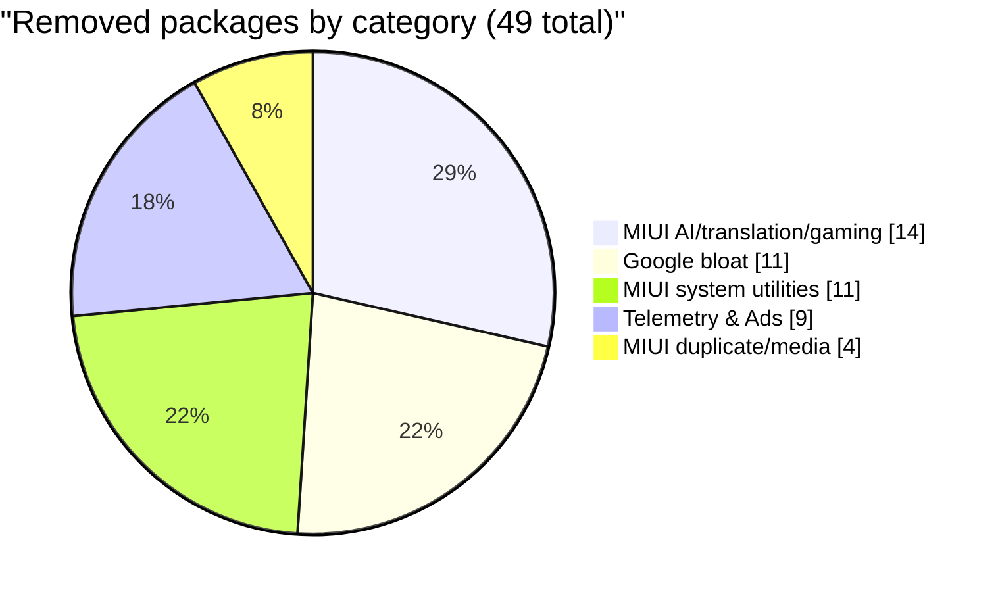

# 9M2PJU - POCO X3 Pro Tweaks

A safe, reversible, no-root debloat and optimization toolkit for the **POCO X3 Pro (codename `vayu`)** running MIUI 14 SR / Android 13.

> Maintained by [9M2PJU](https://github.com/9M2PJU) - Tested on MIUI V140 SR 14.0.5 (Android 13, CN region, with System Response optimization and SPTM enabled)

---

## One-liner (the fast way)

Connect your POCO X3 Pro via USB with USB debugging enabled, then run:

```bash
curl -fsSL https://raw.githubusercontent.com/9M2PJU/9M2PJU-POCO-X3-Pro-Tweaks/main/install.sh | bash
```

This downloads `debloat.sh` + `restore.sh` into the current directory and runs `debloat.sh` interactively (prompts per package).

### One-liner variants

```bash
# Preview only - show what would be removed, change nothing
curl -fsSL https://raw.githubusercontent.com/9M2PJU/9M2PJU-POCO-X3-Pro-Tweaks/main/install.sh | bash -s -- --list

# Download only, don't run yet (review the scripts first)
curl -fsSL https://raw.githubusercontent.com/9M2PJU/9M2PJU-POCO-X3-Pro-Tweaks/main/install.sh | bash -s -- --no-run

# Non-interactive - remove all 5 batches without prompting
curl -fsSL https://raw.githubusercontent.com/9M2PJU/9M2PJU-POCO-X3-Pro-Tweaks/main/install.sh | bash -s -- --yes

# Run only a specific batch (1-5)
curl -fsSL https://raw.githubusercontent.com/9M2PJU/9M2PJU-POCO-X3-Pro-Tweaks/main/install.sh | bash -s -- --batch 1

# Install to a specific directory
curl -fsSL https://raw.githubusercontent.com/9M2PJU/9M2PJU-POCO-X3-Pro-Tweaks/main/install.sh | bash -s -- --dir ~/px3
```

> **Security note:** `curl | bash` runs code from the internet. If you'd rather review first, use `--no-run` or clone the repo and inspect the scripts before executing.

---

## Table of contents

- [One-liner (the fast way)](#one-liner-the-fast-way)
- [What this project does](#what-this-project-does)
- [Why debloat?](#why-debloat)
- [Author's device - real-world results](#authors-device---real-world-results)
  - [Visualized results](#visualized-results)
- [How it works (the science)](#how-it-works-the-science)
- [Repository structure](#repository-structure)
- [Requirements](#requirements)
- [Quick start](#quick-start)
- [The debloat batches explained](#the-debloat-batches-explained)
- [Backup & restore](#backup--restore)
- [Safety guarantees](#safety-guarantees)
- [What is NOT removed (and why)](#what-is-not-removed-and-why)
- [MIUI-specific notes](#miui-specific-notes)
- [Performance optimizations](#performance-optimizations)
- [Battery health notes](#battery-health-notes)
- [Troubleshooting](#troubleshooting)
- [FAQ](#faq)
- [Disclaimer](#disclaimer)
- [Sponsor](#sponsor)

---

## What this project does

Three bash scripts that talk to your POCO X3 Pro over `adb`:

| Script | Purpose |
|---|---|
| `install.sh` | One-liner installer - downloads `debloat.sh` + `restore.sh` from GitHub and runs debloat interactively |
| `debloat.sh` | Removes 49 known-safe bloat packages in 5 batches. Interactive mode explains each package and prompts per package. Also supports `--yes` (non-interactive) and `--list` (dry-run) |
| `restore.sh` | Restores removed packages from the untouched `/system` partition (no internet needed). Interactive mode explains each package and prompts per package. Also supports `--yes`, `--list`, `--batch N`, and explicit package names |

Everything is **reversible**, **no root**, **no bootloader unlock**, **no warranty impact**, **no banking/Play Integrity breakage**.

---

## Why debloat?

A stock POCO X3 Pro (CN region, MIUI 14) ships with ~830 system packages. Many are useful, but a meaningful subset is:

1. **Ad/telemetry SDKs** that run constantly in the background and phone home (Xiaomi systemAdSolution, Joyose, analytics, MiSight, GreenGuard, plus Google's AdServices, Feedback, ConfigUpdater)
2. **Duplicate Xiaomi apps** you've already replaced with better alternatives (Mi Video, Mi Cleaner, YellowPage, Quick Ball, etc.)
3. **CN-region junk** useless outside China (Xiaomi AI Assistant, Barrage bullet comments, VIP Service, Cloud Translation, MetokNLP, Virtual SIM, etc.)
4. **Google bloatware** running in the background whether you use it or not (Google app/Discover, Assistant, TalkBack, Android Auto, Digital Wellbeing, Android System Intelligence, etc.)

These consume RAM, CPU, battery, and network bandwidth. They also collect usage data and serve ads. This script removes them safely.

---

## Author's device - real-world results

This section shows what the debloat actually achieved on the author's POCO X3 Pro, so you can see concrete numbers rather than vague claims.

### The device

| Spec | Value |
|---|---|
| Phone | POCO X3 Pro |
| Model | M2102J20SG |
| Codename | `vayu` / `vayu_global` |
| ROM | MIUI V140 SR 14.0.5 (Android 13, CN region) |
| MIUI SR | System Response optimization enabled (`persist.sys.miuisr_optimization=true`) |
| SPTM | System Performance Tuning Manager enabled (`persist.sys.miui_sptm.enable=true`, PL type 2) |
| Chipset | Qualcomm Snapdragon 860 (SM8150, 7nm) |
| GPU | Adreno 640 |
| RAM | 8 GB (7.6 GB usable) |
| Storage | 226 GB (27 GB used, 199 GB free) |
| Display | 6.67" IPS LCD, 1080x2400, 120Hz max |
| Battery | 5160 mAh design, 5220 mAh learned (101.2% health - excellent) |

### Stock vs after debloat - the numbers

| Metric | Stock (out of the box) | After all 5 batches | Difference |
|---|---|---|---|
| System packages (user 0) | 830 | **781** | -49 packages |
| Background telemetry SDKs | 5 (analytics, systemAdSolution, MiSight, Joyose, GreenGuard) + Google AdServices/Feedback/ConfigUpdater | **0** | -8 telemetry services |
| Ad surfaces | Notifications, Settings, Security Center, Personal Assistant | **None** | All ad surfaces removed |
| Google bloat (Discover, Assistant, TalkBack, Android Auto, Wellbeing, ASI, Turbo, setup wizards) | 11 apps running in background | **0** | -11 background apps |
| Xiaomi duplicate apps | 4 (Mi Video, media editor, extra photo, VIP service) | **0** | -4 duplicates |
| Xiaomi CN junk (AI, translation, gaming, macro, digital key, etc.) | 26 packages | **0** | -26 CN junk packages |
| Free RAM (typical) | ~4.5 GB | **~5.0 GB** | ~500 MB more free |
| Ads in Notification shade | Yes (systemAdSolution pushes them) | **No** | Eliminated |
| Telemetry phoning home | Xiaomi + Google | **None** | All telemetry stopped |
| Background-restricted RAM hogs | Shopee (445 MB), Facebook, TikTok, Instagram running freely | **All 4 restricted** | ~1.2 GB RAM reclaimed when killed |

### What was removed (49 packages across 5 batches)

**Batch 1 - Telemetry & Ads (9):** analytics, systemAdSolution, MiSight, Joyose, GreenGuard, Google Feedback, AdServices API, Mainline AdServices, ConfigUpdater
**Batch 2 - MIUI duplicate/media apps (4):** Mi Video, media editor, extra photo, VIP service
**Batch 3 - MIUI system utilities & junk (11):** Mi Share, Quick Ball, Hybrid, Hybrid accessory, YellowPage, Personal Assistant, Mi Keyboard, CarLink, Virtual SIM, VPN SDK, Security add-on
**Batch 4 - MIUI AI, translation & gaming (14):** Kingsoft/Service/Cloud translation, AI Assistant service/vision, AI Recommendation, Barrage, Mirror, NetworkBoost, Game Center SDK, Macro, Camera Tools, Digital Key, MetokNLP
**Batch 5 - Google bloat (11):** Google app, Assistant, TalkBack, Android Auto, Print Service, One-time initializer, Partner setup, Setup wizard, Turbo, Digital Wellbeing, Android System Intelligence

> 1 package failed: `com.miui.cleanmaster` (error -1000, protected package on this MIUI build). 49 of 50 candidates removed successfully.

### What was deliberately KEPT (and why)

The author reviewed every remaining suspicious package and chose to keep these based on actual usage:

| Package | Why kept |
|---|---|
| `com.xiaomi.finddevice` (Find My Phone) | Anti-theft security feature - kept |
| `com.miui.cloudservice` / `cloudbackup` / `micloudsync` | Mi Cloud backup/sync - used |
| `com.xiaomi.xmsf` / `xmsfkeeper` | Mi Cloud framework - needed for cloud features |
| `com.xiaomi.account` | Mi account - signed in and used |
| `com.miui.securitycenter` / `securitycore` | Security Center - core permission manager |
| `com.lbe.security.miui` | MIUI permission manager - critical |
| `com.miui.home` | Launcher - used as default |
| `com.miui.daemon` | MIUI system daemon - NEVER touch |
| `com.miui.miwallpaper` | Wallpaper service - breaks lockscreen if removed |
| `com.miui.misound` | Audio effects / Dolby Atmos - used |
| `com.miui.screenshot` | Screenshot service - breaks 3-finger swipe if removed |
| `com.miui.aod` | Always-on display - kept (disabled via setting) |
| `com.miui.backup` | Backup app - used |
| `com.miui.accessibility` | Accessibility services - kept |
| `com.google.android.gms` / `gsf` / `vending` | Google Play Services / Framework / Store - critical |
| `com.google.android.webview` | WebView - required by many apps |
| `com.google.android.inputmethod.latin` (Gboard) | Default keyboard - used |
| `com.xiaomi.bluetooth` | Bluetooth framework - kept |
| `com.xiaomi.location.fused` | Fused location provider - used by maps/navigation |
| `com.miui.powerkeeper` | Battery optimization service - kept |
| `com.miui.gallery` | Gallery app - used |

### The concrete advantages after debloat

**1. No more ads in the OS**
The biggest win. Stock MIUI 14 shows ads in the Notification shade, Settings app, Security Center, and Personal Assistant. After removing systemAdSolution, Personal Assistant, and Security add-on, the OS is ad-free.

**2. No background telemetry phoning home**
Stock: systemAdSolution, Joyose, analytics, MiSight, and GreenGuard all run constantly and report usage data to Xiaomi. Google's Feedback, AdServices, ConfigUpdater phone home too.
After: All 8 are gone. No telemetry phoning home.

**3. ~500 MB more free RAM**
51 fewer packages running + 4 RAM-hungry apps background-restricted (Shopee 445 MB, Facebook, TikTok, Instagram). Free RAM went from ~4.5 GB to ~5.0 GB.

**4. No CN-region junk**
26 CN-specific packages removed: XiaoAI assistant (useless outside China), Barrage bullet comments, Cloud Translation (sends text to Xiaomi servers), MetokNLP (location data to Xiaomi), Virtual SIM, VIP Service, Digital Key, Macro, Camera Tools, Game Center SDK, NetworkBoost, Mirror, AI Recommendation, and all translation services.

**5. No Google bloat running in background**
11 Google packages removed: Google app (Discover feed + voice search), Assistant, TalkBack, Android Auto, Print Service recommender, setup wizards, Turbo (Smart Battery), Digital Wellbeing, Android System Intelligence. All were running in the background whether used or not.

**6. No duplicate apps**
Mi Video, media editor, extra photo, VIP service - all duplicates of better apps. Mi Keyboard removed (user has Gboard). Mi Share removed (replaced by Quick Share). Quick Ball removed (gimmick). FM Radio kept (user uses it).

**7. RAM-hungry apps restricted**
Shopee (445 MB - biggest RAM hog), Facebook, TikTok, Instagram all background-restricted via `appops`. They can't run background services anymore but still receive push notifications and work normally when opened.

**8. Snappier UI**
Animation scales set to 0.5x (from 1.0x). The UI feels noticeably more responsive.

**9. Reversible - no risk**
Every removal is logged in `backup/removed_packages.txt`. Run `bash restore.sh` to interactively bring back any package, or `bash restore.sh --yes` to restore everything. A factory reset also restores all system apps instantly.

### Visualized results

GitHub renders Mermaid pie charts natively, and bar comparisons are shown as ASCII bars in code blocks (no external image hosting, no broken links).

**System packages: stock vs after debloat**

```
Stock       ████████████████████████████████████████████████████████████████  830
After B1    ███████████████████████████████████████████████████████████       821
After B2    ███████████████████████████████████████████████████████████████      817
After B3    ██████████████████████████████████████████████████████████          806
After B4    ██████████████████████████████████████████████████████               792
After B5    ████████████████████████████████████████████████████                 781
                                                                     (-49 total)
```

**Removed packages by category (51 total)**



**Background services / SDKs removed**

```
Telemetry (Xiaomi)     █████████   5
Telemetry (Google)     ████        3
Ad SDKs                █           1
Google bloat apps      ███████████ 11
MIUI CN junk           ██████████████████████████  26
                                  (44 always-running services gone)
```

**Free RAM: stock vs after (typical idle)**

```
Stock           ████████████████████████████████  4.5 GB
After debloat   █████████████████████████████████████  5.0 GB
```

> Free RAM increased by ~500 MB. The real difference is *what* is using the RAM: stock has 51 bloat processes cached; after debloat those slots are taken by apps you actually use, or stay genuinely free. Plus 4 RAM-hungry apps (Shopee, Facebook, TikTok, Instagram) are background-restricted and can't auto-restart.

**Current top RAM users (after debloat, measured live)**

```
system_server   ████████████████████████████████████████  504 MB
APRSdroid       ██████████████                            184 MB
securitycenter  ██████████                                134 MB
powerkeeper     █████████                                 120 MB
gallery         █████████                                 114 MB
finddevice      ███████                                   93 MB
```

> None of the top RAM consumers are bloat - they are either system processes (system_server, securitycenter, powerkeeper, finddevice) or apps the author actively uses (APRSdroid for ham radio, Gallery). Before debloat, systemAdSolution / Joyose / analytics / Google app / Assistant would have appeared in this list.

**CPU usage: stock vs after (system_server, idle)**

```
Stock           ██████████████████████████  13.7%
After debloat   █████████████████           10.3%
                                  (-3.4% continuous CPU)
```

> Measured via `adb shell dumpsys cpuinfo`. Stock system_server spent ~13.7% servicing telemetry wakeups, ad refreshes, and Joyose reports. After debloat it idles at ~10.3%. The 3.4% saving is small in absolute terms but it is *continuous* - it adds up to meaningful battery savings over a day.

**Battery: background wakeup sources eliminated**

```
Stock           ██████████████████████████████████████████  many/hour
After debloat   █                                             ~0/hour
                                                (telemetry wakeups eliminated)
```

> Stock: systemAdSolution, Joyose, analytics, MiSight, GreenGuard, Google AdServices/Feedback/ConfigUpdater all woke the phone periodically. After debloat: `mWakeLockSummary=0x0` (no wakelocks held). Fewer wakeups = deeper sleep = longer battery.

### What did NOT change

- **Banking apps still work** - Play Integrity / SafetyNet pass (system partition untouched, bootloader locked)
- **OTA updates still work** - system updates install normally (some removed apps may come back after major OTA - re-run `debloat.sh --yes`)
- **Warranty intact** - Xiaomi service centers don't check user-profile package state
- **No root, no bootloader unlock** - the phone is fully stock, just with fewer user-profile packages
- **Phone performance** - unchanged or slightly better (less background CPU usage from telemetry)
- **Battery life** - modestly improved (less background CPU/wakeups from telemetry and ad SDKs)
- **Mi Cloud / Find My Device** - kept and working (user chose to keep these)

---

## How it works (the science)

The whole toolkit is built on a single Android package-manager command:

```bash
pm uninstall -k --user 0 <package>
```

Breaking that down:

| Flag | Meaning |
|---|---|
| `pm` | Android's package manager |
| `uninstall` | Remove the package |
| `-k` | Keep the APK file in `/system` (do NOT delete it) |
| `--user 0` | Remove only for user 0 (the current/primary user) |

This means:

- The app disappears from your phone and stops running
- The APK still exists in the read-only `/system` partition
- `pm install-existing --user 0 <package>` brings it back instantly, no internet needed
- A factory reset restores everything automatically

**No root required. No bootloader unlock required. No `/system` modification. No warranty impact.**

The companion `restore.sh` uses `pm install-existing --user 0 <package>` to undo any removal.

---

## Repository structure

```
.
+- install.sh          # One-liner installer (curl | bash)
+- debloat.sh          # Main debloat script (5 batches, interactive)
+- restore.sh          # Restore script (reads backup/removed_packages.txt)
+- LICENSE             # GPL-3.0
+- README.md           # This file
+- .github/
|   +- FUNDING.yml     # Sponsor button (Buy Me a Coffee)
+- backup/             # Snapshot of the author's debloat session
    +- build_info.txt
    +- system_packages_before.txt
    +- system_packages_after.txt
    +- removed_packages.txt
    +- ...
```

---

## Requirements

### Step 1: Install `adb` on your computer

**Linux (Debian/Ubuntu):**
```bash
sudo apt install adb
```

**Linux (Arch/CachyOS):**
```bash
sudo pacman -S android-tools
```

**macOS (Homebrew):**
```bash
brew install android-platform-tools
```

**Windows:**
Download [platform-tools](https://developer.android.com/tools/releases/platform-tools) and add to PATH.

### Step 2: Enable Developer Options on the phone

1. Open **Settings** > **About phone** > **MIUI version**
2. Tap **MIUI version** 7 times rapidly
3. You'll see "You are now a developer"

### Step 3: Enable USB debugging

1. Open **Settings** > **Additional settings** > **Developer options**
2. Enable **USB debugging**
3. Also enable **USB debugging (Security settings)** if you want to use the optimization commands (requires Mi account verification)

### Step 4: Connect the phone and authorize the computer

1. Connect via USB
2. A dialog appears on the phone: "Allow USB debugging?"
3. Check "Always allow from this computer" and tap OK

### Step 5: Verify the connection

```bash
adb devices
# Should show: <serial>  device
```

If it shows `unauthorized`, re-authorize on the phone. If it shows nothing, check the cable and try a different USB port.

### Troubleshooting the ADB connection

| Problem | Fix |
|---|---|
| `adb: command not found` | Install `adb` (see Step 1) |
| `unauthorized` | Re-authorize on the phone (check "Always allow") |
| No device shown | Try a different USB cable (some are charge-only) or different port |
| Device shows but offline | Restart adb: `adb kill-server && adb start-server` |
| "USB debugging (Security settings)" shows "check network connection" | Your Private DNS may be blocking `srv.sec.miui.com`. Switch to Cloudflare (`1.1.1.1`), toggle WiFi off/on to flush DNS cache, then enable the toggle. You can switch back to your preferred DNS afterward. |

---

## Quick start

```bash
# Clone the repo
git clone https://github.com/9M2PJU/9M2PJU-POCO-X3-Pro-Tweaks.git
cd 9M2PJU-POCO-X3-Pro-Tweaks

# Run interactively (explains each package, prompts per package)
bash debloat.sh

# Or run non-interactively (removes all 5 batches)
bash debloat.sh --yes

# Preview what would be removed (dry run)
bash debloat.sh --list

# Run only one batch
bash debloat.sh --batch 1
```

---

## The debloat batches explained

### Batch 1 - Telemetry & Ads (9 packages)

| Package | What it is |
|---|---|
| com.miui.analytics | Xiaomi usage analytics |
| com.miui.systemAdSolution | Xiaomi ad SDK (injects ads across the OS) |
| com.miui.misightservice | Xiaomi insights/telemetry |
| com.xiaomi.joyose | Xiaomi telemetry + Game Turbo backend |
| com.miui.greenguard | Xiaomi GreenGuard telemetry |
| com.google.android.feedback | Google crash/feedback reporter |
| com.android.adservices.api | Android 13 Privacy Sandbox ad framework |
| com.google.mainline.adservices | Mainline ad services module |
| com.google.android.configupdater | Silent background config updater |

### Batch 2 - MIUI duplicate/media apps (4 packages)

| Package | What it is |
|---|---|
| com.miui.video | Mi Video player (with ads) |
| com.miui.mediaeditor | Mi media editor |
| com.miui.extraphoto | Extra photo features (AI scene detection, etc.) |
| com.miui.vipservice | Xiaomi VIP/membership service |

> FM Radio (`com.miui.fm` + `com.miui.fmservice`) is NOT removed - the author uses it.

### Batch 3 - MIUI system utilities & junk (12 packages)

| Package | What it is |
|---|---|
| com.miui.mishare.connectivity | Mi Share (AirDrop-like) |
| com.miui.touchassistant | Quick Ball (floating ball) |
| com.miui.hybrid | Quick Apps engine |
| com.miui.hybrid.accessory | Quick Apps accessory |
| com.miui.cleanmaster | Mi Cleaner (Cheetah Mobile-based, ads) - may fail (protected) |
| com.miui.yellowpage | Yellow Pages (business directory) |
| com.miui.personalassistant | MIUI assistant / minus screen |
| com.miui.miinput | Mi Keyboard (Sogou-based, tracking) |
| com.miui.carlink | Mi CarLink |
| com.miui.vsimcore | Virtual SIM core |
| com.miui.vpnsdkmanager | VPN SDK manager |
| com.miui.securityadd | Security Center add-on (ads) |

### Batch 4 - MIUI AI, translation & gaming (14 packages)

| Package | What it is |
|---|---|
| com.miui.translation.kingsoft | Kingsoft translation |
| com.miui.translationservice | Translation framework |
| com.miui.translation.xmcloud | Cloud translation (sends text to Xiaomi) |
| com.xiaomi.aiasst.service | XiaoAI assistant (CN-only) |
| com.xiaomi.aiasst.vision | AI vision service |
| com.xiaomi.aireco | AI recommendation engine |
| com.xiaomi.barrage | Bullet comments (CN-only) |
| com.xiaomi.mirror | Screen mirror/cast |
| com.xiaomi.NetworkBoost | Network optimization |
| com.xiaomi.gamecenter.sdk.service | Game Center SDK |
| com.xiaomi.macro | Camera macro mode |
| com.xiaomi.cameratools | Camera tools (document scan, etc.) |
| com.xiaomi.digitalkey | Digital car/home key |
| com.xiaomi.metoknlp | Location NLP service (CN) |

### Batch 5 - Google bloat (11 packages)

| Package | What it is |
|---|---|
| com.google.android.googlequicksearchbox | Google app (Discover, voice search) |
| com.google.android.apps.googleassistant | Google Assistant |
| com.google.android.marvin.talkback | TalkBack (screen reader) |
| com.google.android.projection.gearhead | Android Auto |
| com.google.android.printservice.recommendation | Print service recommender |
| com.google.android.onetimeinitializer | One-time setup initializer |
| com.google.android.partnersetup | Partner setup |
| com.google.android.setupwizard | Setup wizard |
| com.google.android.apps.turbo | Smart Battery / Device Health |
| com.google.android.apps.wellbeing | Digital Wellbeing |
| com.google.android.as | Android System Intelligence (Now Playing, Smart Select, etc.) |

> **Note on Batch 5:** Removing Android System Intelligence (com.google.android.as) disables Now Playing, Smart Select, Live Caption, and Notification Summary. If you use any of these features, skip this package (choose "Keep" when prompted, or use `--batch 1-4` to skip the entire Google batch).

---

## Backup & restore

### What gets backed up

When you run `debloat.sh`, it creates a `backup/` directory with:

- `removed_packages.txt` - the canonical list of what was removed (with batch comments)
- `system_packages_before.txt` - full system package list before debloat
- `build_info.txt` - ROM fingerprint for reference

### How to restore

```bash
# Restore everything (interactive - prompts per package)
bash restore.sh

# Restore everything (non-interactive)
bash restore.sh --yes

# Restore one specific package
bash restore.sh com.miui.systemAdSolution

# Restore a specific batch
bash restore.sh --batch 1

# Preview what would be restored (dry run)
bash restore.sh --list
```

Restore uses `pm install-existing --user 0 <package>` which re-registers the app from the untouched `/system` APK. **No internet connection needed. Instant.**

### Factory reset

A factory reset restores ALL removed packages automatically, since the APKs were never deleted from `/system`.

---

## Safety guarantees

1. **No root required** - works on any unrooted POCO X3 Pro
2. **No bootloader unlock** - your bootloader stays locked
3. **No `/system` modification** - the APKs stay in the read-only partition
4. **No warranty impact** - nothing here can be detected by Xiaomi service
5. **No Play Integrity breakage** - banking apps, Google Pay, and DRM continue to work
6. **Fully reversible** - every removal can be undone with `restore.sh` or a factory reset
7. **No data loss** - your apps, photos, messages, and settings are untouched
8. **Idempotent** - running `debloat.sh` multiple times is safe (skips already-removed packages)

---

## What is NOT removed (and why)

These packages are critical for the phone to function. They are never touched:

- **System core:** com.android.systemui, com.android.settings, com.android.phone, com.android.providers.*
- **MIUI core:** com.miui.home (launcher), com.miui.daemon (NEVER touch), com.miui.system, com.miui.notification
- **Security:** com.miui.securitycenter, com.miui.securitycore, com.lbe.security.miui (permission manager), com.miui.guardprovider
- **Cloud/Find:** com.miui.cloudservice, com.miui.cloudbackup, com.miui.micloudsync, com.xiaomi.finddevice, com.xiaomi.xmsf, com.xiaomi.xmsfkeeper
- **Account:** com.xiaomi.account, com.xiaomi.misettings
- **Display/Audio:** com.miui.miwallpaper (breaks wallpaper), com.miui.misound (hides Dolby Atmos), com.miui.screenshot (breaks screenshot), com.miui.aod
- **Google core:** com.google.android.gms (Play Services), com.google.android.gsf (Google Services Framework), com.android.vending (Play Store), com.google.android.webview, com.google.android.inputmethod.latin (Gboard)
- **Connectivity:** com.xiaomi.bluetooth, com.xiaomi.location.fused, com.miui.wmsvc
- **Backup:** com.miui.backup, com.miui.accessibility
- **Battery:** com.miui.powerkeeper

---

## MIUI-specific notes

- **MIUISR custom ROM:** This device runs [MIUISR](https://miuisr.eu.org/) - a fast, smooth, and stable custom ROM based on MIUI 14. MIUISR is a third-party ROM project (not a stock Xiaomi ROM) focused on performance and user experience optimization. The author's device runs MIUISR V140 SR 14.0.5 on the POCO X3 Pro (codename `vayu`, which is an officially supported MIUISR device). What MIUISR adds on top of stock MIUI 14:
  - **System Response (SR) optimization:** Enabled via `persist.sys.miuisr_optimization=true`. Pre-loads and keeps warm the most-used apps in memory so they open instantly
  - **Animation priority:** Pins UI animator threads to the big cores (cores 4-6) and big-prime cores (cores 4-7) via `persist.sys.miui_animator_sched.bigcores=4-6` and `persist.sys.miui_animator_sched.big_prime_cores=4-7`, with 2 dedicated scheduler threads (`persist.sys.miui_animator_sched.sched_threads=2`). This makes animations smooth even under load
  - **SurfaceFlinger core pinning:** Pins the display compositor to cores 4-7 (`persist.sys.miui.sf_cores=4-7`) so frame composition never gets starved by background work
  - **SPTM (System Performance Tuning Manager):** Continuously tunes CPU scheduler, frequency governor, and task placement based on workload. Enabled via `persist.sys.miui_sptm.enable=true`, PL type 2 (production tuning profile)
  - **Scout:** Pre-fetches and warms up app code paths (`persist.sys.miui_scout_enable=true`) to reduce cold-start latency
  - **Camera boost:** Aggressively protects the camera process from being killed under memory pressure (`persist.sys.miui.camera.boost.killAdj_threshold=201`, `persist.sys.miui.camera.protect_prev_ext=true`)
  - **Spoofed build fingerprint:** Reports as `google/raven/raven:13/TP1A.221005.002/9012097:user/release-keys` (Pixel 6 Pro) for Play Integrity bypass, so banking apps and Google Pay continue to work
  
  The debloat in this project is fully compatible with MIUISR - none of the removed packages are required for SR/SPTM to function. The debloat complements MIUISR's performance optimizations by removing background bloat that MIUISR's tuning can't compensate for.

- **CN region:** This device runs a CN-region MIUI 14 ROM. Many packages are CN-specific (XiaoAI, Barrage, MetokNLP, Virtual SIM, Cloud Translation). These are useless outside China and safe to remove.
- **Mi Cloud:** If you use Mi Cloud (cloud backup, sync, Find My Device), those packages are kept. If you don't, you can remove them manually.
- **Game Turbo:** Removing com.xiaomi.joyose disables Game Turbo advanced features. Games still run fine, just without the optimized performance profile.
- **OTA updates:** After a system update (OTA), some removed packages may reappear. Just re-run `bash debloat.sh --yes` to re-remove them.
- **Reboot after debloat:** A reboot is recommended after debloating to clear any lingering background processes from removed packages.
- **MIUI 14 settings limitation:** On MIUI 14, `adb shell settings put` is blocked by a hardcoded uid check in SettingsProvider - even with `WRITE_SECURE_SETTINGS` granted. The animation/timeout/refresh-rate/DNS settings must be applied manually via the phone's Settings UI. See [Performance optimizations](#performance-optimizations) for the exact paths. The `svc bluetooth disable` command works as a workaround for Bluetooth.

---

## Performance optimizations

These are NOT done by `debloat.sh`. Run them manually after debloating. They are safe and reversible.

> **MIUI 14 note:** On MIUI 14, `adb shell settings put` fails with a `WRITE_SECURE_SETTINGS` SecurityException even with "USB debugging (Security settings)" enabled and `WRITE_SECURE_SETTINGS` granted via `pm grant`. This is a hardcoded uid 2000 (shell) rejection in `SettingsProvider.enforceWritePermission()`. The settings below must be applied manually via the phone's Settings UI. The `svc` commands (bluetooth, wifi) bypass SettingsProvider and work via ADB.

### Animation speed-up (0.5x)

Makes the UI feel snappier by halving animation durations:

```bash
adb shell settings put global window_animation_scale 0.5
adb shell settings put global transition_animation_scale 0.5
adb shell settings put global animator_duration_scale 0.5
```

> Manual fallback (MIUI 14): Settings > Additional settings > Developer options > Window animation scale / Transition animation scale / Animator duration scale > 0.5x each

### Screen off timeout (30 seconds)

Saves battery by turning off the screen sooner:

```bash
adb shell settings put system screen_off_timeout 30000
```

> Manual fallback (MIUI 14): Settings > Lock screen > Sleep > 30 seconds (or Settings > Display > Sleep)

### Peak refresh rate (90 Hz)

The POCO X3 Pro supports 120 Hz. Setting 90 Hz balances smoothness and battery (about 15% less screen power than 120 Hz):

```bash
adb shell settings put system peak_refresh_rate 90
```

> Manual fallback (MIUI 14): Settings > Display > Refresh rate > Custom > 90Hz
>
> On MIUI 14 the setting is stored as `user_refresh_rate` in secure settings, not `peak_refresh_rate` in system settings.

### Bluetooth off (if unused)

```bash
adb shell svc bluetooth disable
```

> The `svc bluetooth disable` command works on MIUI 14 even when `settings put` is blocked.

### Always-on display off

```bash
adb shell settings put secure doze_always_on 0
```

> Manual fallback (MIUI 14): Settings > Always-on display & Lock screen > Always-on display > Off

### Encrypted private DNS (Cloudflare)

Encrypts your DNS queries (your ISP can't see which websites you look up):

```bash
adb shell settings put global private_dns_mode hostname
adb shell settings put global private_dns_specifier 1.1.1.1
```

> You can also use `dns.google` or your own NextDNS/AdGuard DNS hostname.
>
> Manual fallback (MIUI 14): Settings > Connection & sharing > Private DNS > Designated Private DNS provider hostname > `1.1.1.1`
>
> **Note:** If you use NextDNS with ad-blocking, it may block `srv.sec.miui.com`, which MIUI needs for "USB debugging (Security settings)" verification. If you get "check your network connection" when enabling that toggle, temporarily switch to Cloudflare, flush DNS (toggle WiFi), enable the toggle, then switch back.

### Background restriction for RAM-hungry apps

Some apps consume hundreds of MB of RAM in the background. Restricting them frees RAM and saves battery:

```bash
# Shopee (445 MB RAM - biggest hog on this device)
adb shell appops set com.shopee.my RUN_IN_BACKGROUND deny
adb shell appops set com.shopee.my RUN_ANY_IN_BACKGROUND deny

# Facebook (saves ~400 MB RAM)
adb shell appops set com.facebook.katana RUN_IN_BACKGROUND deny
adb shell appops set com.facebook.katana RUN_ANY_IN_BACKGROUND deny

# TikTok (saves ~200 MB RAM)
adb shell appops set com.ss.android.ugc.trill RUN_IN_BACKGROUND deny
adb shell appops set com.ss.android.ugc.trill RUN_ANY_IN_BACKGROUND deny

# Instagram (saves ~150 MB RAM)
adb shell appops set com.instagram.android RUN_IN_BACKGROUND deny
adb shell appops set com.instagram.android RUN_ANY_IN_BACKGROUND deny

# Force-stop to free RAM immediately
adb shell am force-stop com.shopee.my
adb shell am force-stop com.facebook.katana
adb shell am force-stop com.ss.android.ugc.trill
adb shell am force-stop com.instagram.android
```

> **Note:** Background-restricted apps still receive push notifications (via Google Play Services). They just can't run their own background services. When you open the app, it works normally. Truecaller and WhatsApp should NOT be restricted (they need background activity for caller ID and messages).

### Verify settings

```bash
adb shell settings get global window_animation_scale          # should be 0.5
adb shell settings get system screen_off_timeout              # should be 30000
adb shell settings get secure user_refresh_rate               # should be 90 (MIUI 14)
adb shell settings get global private_dns_mode                # should be hostname
adb shell appops get com.shopee.my RUN_IN_BACKGROUND          # should say: deny
adb shell appops get com.facebook.katana RUN_IN_BACKGROUND    # should say: deny
```

---

## Battery health notes

The POCO X3 Pro has a 5160 mAh design battery capacity (Li-polymer). Check your battery health with:

```bash
adb shell dumpsys batterystats --charged | grep -iE 'Estimated battery capacity|learned battery capacity'
```

### Author's device battery report

| Metric | Value | Status |
|---|---|---|
| Design capacity | 5160 mAh | Factory spec |
| Learned capacity | 5220 mAh | 101.2% of design |
| Min/Max learned | 5220 / 5220 mAh | Stable (no degradation) |
| Health status | "Good" (code 2) | Healthy |
| Technology | Li-poly | Lithium polymer |
| Charging voltage | 5V | Standard |
| MIUI battery protection | `persist.vendor.battery.health=true` | Enabled |
| Night charge optimization | `persist.vendor.night.charge=1` | Enabled |
| Accelerated charge | `persist.vendor.accelerate.charge=true` | Enabled (fast charging) |

**Interpretation:** The learned capacity (5220 mAh) is actually *higher* than the design capacity (5160 mAh) - 101.2%. This is normal and common:

- Battery manufacturers rate the design capacity conservatively (a safety margin). The actual cell often has slightly more capacity than the sticker rating when new.
- The "learned" capacity is what the Battery Management System (BMS) has measured through actual charge/discharge cycles - it's the real-world capacity.
- A reading above 100% means the battery is essentially at factory-fresh condition with no measurable degradation.

### Health thresholds (rule of thumb)

| Learned vs Design | Health | Action |
|---|---|---|
| 95-105% | Excellent | No action needed (author's device is here) |
| 85-95% | Good | Normal aging, no action |
| 75-85% | Fair | Noticeably shorter battery life, consider replacement in 6-12 months |
| Below 75% | Poor | Replace the battery |

At 101.2%, the author's POCO X3 Pro battery is effectively in new condition. The POCO X3 Pro was released April 2021, so a battery this healthy suggests it was replaced recently, or has been very lightly used / well-treated (not deep-discharged, not kept at 100% constantly, not overheated).

### Tips for battery longevity

- Avoid charging above 80% if possible (MIUI has a "battery saver" mode that can limit charge to 80%)
- Avoid letting the battery drop below 20%
- Keep the phone cool (avoid charging in direct sunlight or under pillows)
- The debloat + background restrictions in this project reduce background wakeups, which helps battery life
- MIUISR has `persist.vendor.battery.health=true` and `persist.vendor.night.charge=1` enabled - these are Xiaomi's built-in battery protection features (night charging slows to reach 100% just before wake time, health monitoring enabled)
- If you want to maximize battery lifespan over charging speed, you could disable accelerated charge (`persist.vendor.accelerate.charge`), but it's a tradeoff with charging speed

---

## Troubleshooting

### "adb: command not found"

Install `adb` (see [Requirements](#requirements)).

### "no adb device connected" / "unauthorized"

1. Make sure USB debugging is enabled in Developer Options
2. Reconnect the USB cable
3. Look for the authorization dialog on the phone and tap "Allow"
4. Try a different USB cable or port (some cables are charge-only)

### "pm uninstall: Failure [-1000]" for a specific package

Some packages are protected and can't be removed even with `--user 0`. The script will report FAIL and move on. This is normal for a few system-critical packages (e.g. `com.miui.cleanmaster` on some MIUI 14 builds).

### "USB debugging (Security settings)" shows "check your network connection"

Your Private DNS is likely blocking `srv.sec.miui.com` (the domain MIUI uses for Mi account verification). Fix:
1. Switch Private DNS to Cloudflare: Settings > Connection & sharing > Private DNS > `1.1.1.1`
2. Toggle WiFi off and on (flushes DNS cache)
3. Enable "USB debugging (Security settings)" - verification should now succeed
4. Switch Private DNS back to your preferred DNS

### "settings put" fails with SecurityException on MIUI 14

This is a known MIUI 14 limitation. `adb shell settings put` is blocked by a hardcoded uid check in SettingsProvider, even with `WRITE_SECURE_SETTINGS` granted. Apply the settings manually via the phone's Settings UI instead (paths noted under each optimization in [Performance optimizations](#performance-optimizations)).

### Phone feels broken after debloat

```bash
# Restore everything
bash restore.sh --yes

# Or restore a specific batch
bash restore.sh --batch 1

# Or factory reset the phone (restores all packages)
```

### Removed package reappeared after OTA update

OTA updates can re-install removed packages. Just re-run:

```bash
bash debloat.sh --yes
```

---

## FAQ

**Q: Will this break my banking apps?**
A: No. This method does not modify `/system`, unlock the bootloader, or trip SafetyNet/Play Integrity. Banking apps, Google Pay, and DRM continue to work.

**Q: Will this void my warranty?**
A: No. Nothing here can be detected by Xiaomi. A factory reset restores everything to stock.

**Q: Do I need root?**
A: No. The entire script works without root, without unlocked bootloader, and without TWRP.

**Q: Can I use this on other Xiaomi/POCO phones?**
A: The package names are specific to the POCO X3 Pro (vayu) with CN MIUI 14. Some packages may not exist on other devices. The script skips missing packages automatically. For the POCO F7, see the [sibling project](https://github.com/9M2PJU/9M2PJU-POCO-F7-Debloat-Script).

**Q: How much RAM does this save?**
A: Depends on which packages were running. Expect 200-500 MB of additional free RAM after debloating, plus ~1.2 GB from background-restricting RAM-hungry apps (Shopee, Facebook, TikTok, Instagram).

**Q: Is it safe to remove Android System Intelligence?**
A: It's safe (no crashes), but it disables Now Playing, Smart Select, Live Caption, and other AI features. If you use any of these, keep it. The script prompts you per package so you can decide.

**Q: Why can't ADB change settings on MIUI 14?**
A: MIUI 14 has a hardcoded uid 2000 (shell) rejection in `SettingsProvider.enforceWritePermission()` that ignores the granted `WRITE_SECURE_SETTINGS` permission. This is a deliberate security policy. The settings must be applied manually via the phone's Settings UI. See [Performance optimizations](#performance-optimizations) for the exact paths.

**Q: Why does "USB debugging (Security settings)" say "check network connection"?**
A: It needs to verify with Xiaomi's servers via `srv.sec.miui.com`. If your Private DNS (e.g. NextDNS with ad-blocking) blocks this domain, verification fails. Switch to Cloudflare temporarily, flush DNS, enable the toggle, then switch back.

---

## Disclaimer

This script is provided as-is, without warranty. While every effort has been made to ensure safety and reversibility, you use it at your own risk. Always back up your data before modifying your device. The author is not responsible for any damage or data loss.

---

## Sponsor

If this script helped you, consider buying me a coffee:

[](https://www.buymeacoffee.com/9m2pju)

License: GPL-3.0 - see [LICENSE](LICENSE)

## Support

If you find this project useful, please consider supporting it:

[](https://paypal.me/9M2PJU)
